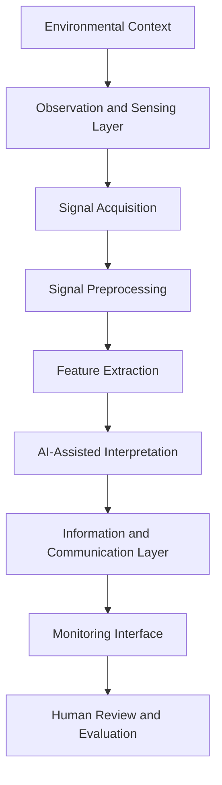

# PROJECT DHWANI 2.4 — System Architecture

## 1. Introduction

PROJECT DHWANI 2.4 is designed around a multi-layer acoustic and environmental monitoring architecture.

The proposed system explores the integration of distributed sensing, signal processing, artificial intelligence, edge computing, and communication technologies.

Its architecture consists of interconnected subsystems that collectively contribute to environmental signal acquisition, interpretation, and information presentation.

This document describes the high-level conceptual architecture of DHWANI 2.4.

---

## 2. Overall System Architecture

The architecture is organized into five major functional components:

1. Observation and sensing concepts
2. Environmental signal acquisition
3. Intelligent signal processing
4. Communication infrastructure
5. Monitoring and information interface

These components represent the conceptual organization of the research system, rather than a claim of completed hardware integration.

---

## 3. Major System Components

### 3.1 Hawk-2 — Aerial Observation Concept

Hawk-2 is the aerial observation component described in the DHWANI 2.4 technical whitepaper.

Its role within the high-level architecture is to represent an additional observation platform that complements the distributed sensing concepts.

Development status: Refer to the project's claims-and-evidence register.

### 3.2 Panchatattva — Terrain-Specific Sensing Concepts

Panchatattva represents five environment-specific sensing concepts.

The five named variants are:

| Variant | Environment |
|---|---|
| Maru | Desert |
| Hima | Mountain |
| Nadi | Riverine |
| Vana | Jungle |
| Sagara | Maritime |

The underlying design philosophy is environmental adaptability.

Different environmental conditions may influence sensor selection, signal characteristics, enclosure requirements, and data interpretation.

### 3.3 Fence Sentinel

Fence Sentinel is a vibration-monitoring concept documented in the technical whitepaper.

It represents a separate sensing component within the overall research architecture.

Its conceptual role is to study environmental and structural vibration information.

### 3.4 AI Brain

The AI Brain represents the intelligent signal-processing and interpretation layer.

Its research areas include:

- Signal preprocessing
- Feature extraction
- Acoustic pattern analysis
- Seismic signal interpretation
- Multi-modal information analysis
- Edge-based inference

The objective is to explore how computational intelligence can assist in interpreting complex environmental signals.

### 3.5 Mesh Backbone

The Mesh Backbone represents the distributed communication layer.

Its high-level purpose is to support information exchange between system components and the monitoring interface.

Communication reliability, interoperability, data integrity, and regulatory compliance are important research considerations.

---

## 4. High-Level Data Flow

The proposed information flow follows this conceptual sequence:

1. Environmental observations are acquired.
2. Relevant signals are processed.
3. Features are extracted from the acquired information.
4. Computational models analyze signal patterns.
5. Relevant information is communicated.
6. The monitoring interface presents information for human review.

---

## 5. Conceptual Architecture Diagram

This diagram represents the research-level information flow, not a validated implementation.

---

## 6. AI and Signal Processing Layer

The AI Brain is a major research component of DHWANI.

The conceptual processing pipeline includes:

| Stage | Function |
|---|---|
| Signal Acquisition | Collect environmental observations |
| Preprocessing | Prepare signals for analysis |
| Feature Extraction | Derive useful signal characteristics |
| Model Inference | Analyze patterns using computational models |
| Interpretation | Present model outputs for review |

Potential evaluation areas include:

- Classification performance
- False-positive rate
- Signal quality
- Environmental robustness
- Processing efficiency
- Model reliability

No performance values should be considered validated without corresponding experimental evidence.

---

## 7. Integration Considerations

The integration of multiple subsystems introduces several engineering challenges.

Important considerations include:

- Hardware and software compatibility
- Sensor-data consistency
- Signal quality
- Power efficiency
- Communication reliability
- Environmental robustness
- Data security
- Privacy
- System maintainability

These considerations will guide future development and validation.

---

## 8. Current Development Status

The technical whitepaper provides a documented system concept and proposed architecture.

The implementation status of individual components must be recorded separately.

The following evidence categories should be maintained:

| Component | Evidence Required |
|---|---|
| Hawk-2 | Approved design and development records |
| Panchatattva | Component-level design records |
| Fence Sentinel | Engineering documentation and test records |
| AI Brain | Software, model and evaluation records |
| Mesh Backbone | Communication testing and integration records |

---

## 9. Future Development

Future development activities will focus on:

1. Refinement of the conceptual architecture.
2. Development of independently testable components.
3. Signal-processing experimentation.
4. AI model evaluation.
5. Software and hardware integration.
6. Controlled validation.
7. Documentation of verified results.

---

## 10. Conclusion

The DHWANI 2.4 architecture explores a modular approach to acoustic and environmental monitoring.

By organizing observation, sensing, signal processing, intelligent interpretation, and communication into distinct functional layers, the project establishes a framework for future research and engineering development.

The architecture will evolve as individual components are implemented, tested, and validated.

---

**PROJECT DHWANI 2.4**

*The Panchatattva Acoustic Defence Grid*

Technical Documentation | System Architecture
